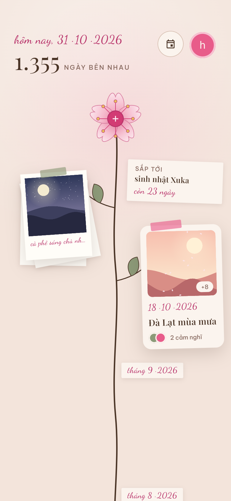
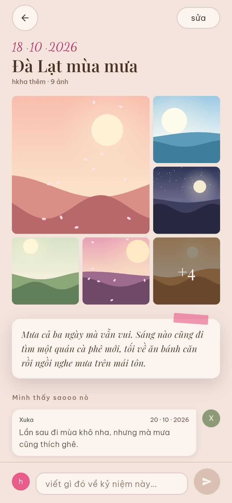
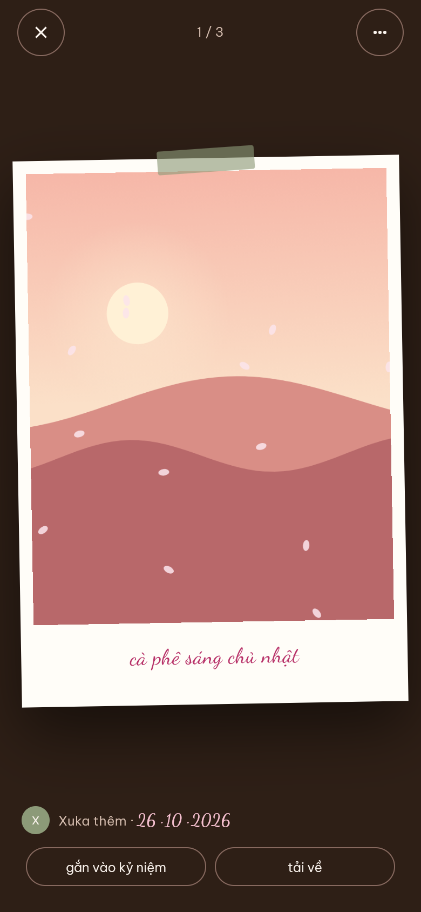
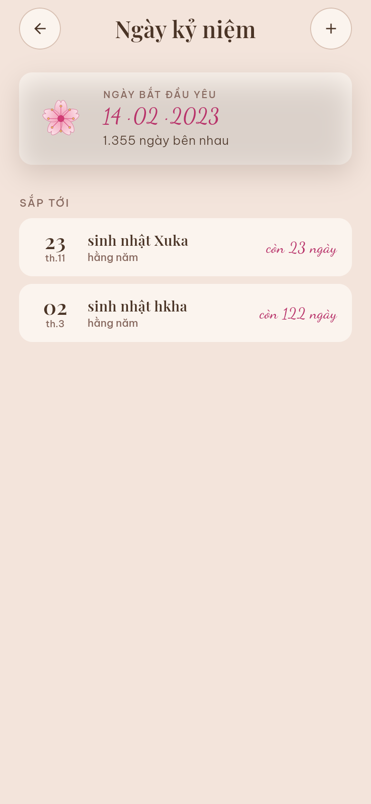
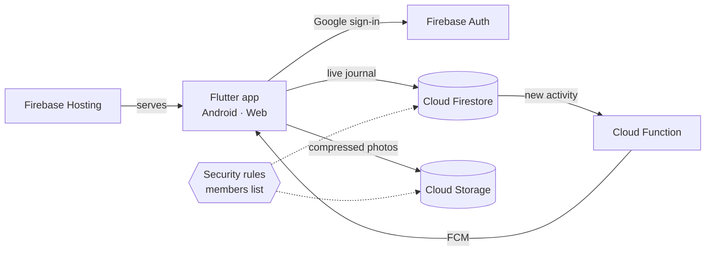

<div align="center">


# us-together

[](https://flutter.dev)
[](https://firebase.google.com)
[](https://github.com/hkhaNguyen/us-together/releases)
[](LICENSE)

A shared photo journal for two, grown as a cherry-blossom stem.

[Overview](#overview) · [Features](#features) · [Run your own](#run-your-own) · [Deploy](#deploy) · [Development](#development) · [Tiếng Việt](README.vi.md)






</div>

## Overview

us-together is a private journal that two people fill together. Every photo
and moment either of you adds sprouts on a branch of one stem: the newest
sits under the flower at the top, the oldest down by the pot. The interface
is in Vietnamese.

It runs on Android and in the browser from one Flutter codebase, with
Firebase as the whole backend. Google sign-in says who you are, the security
rules decide whether you're one of the two, and the only server code is one
Cloud Function that sends notifications.



The live site, [ustogether.space](https://ustogether.space), and the APK
only open for the two people in this journal. Anyone else who signs in is
told their account isn't in the book. To use it yourselves, run your own copy.

## Features

- **The stem**: photos and moments alternate left and right along one stem,
  with month markers, from the flower down to the pot.
- **Loose photos**: each batch hangs as one polaroid stack with a shared
  title. Add more photos to a stack later, or pick its cover.
- **Moments (kỷ niệm)**: a dated story with photos and a cover, which each of
  you can answer with your own reflection.
- **Anniversaries**: a day counter, a countdown to the next one, and on the
  day itself a heart with confetti.
- **Xem từ đầu**: replays the journal from the pot up, regrowing the stem
  branch by branch and ending on the day count.
- **Notifications** (Android): when one of you adds photos, a moment or a
  reflection, the other one hears about it, once per batch.
- **Share from the gallery** (Android): "Share → us-together" opens the
  add-photos sheet with those photos already in.
- **Trash**: deleted things wait 30 days and either of you can restore them.
- **Photos**: capture dates come from EXIF, files are compressed on the
  device (WebP, or JPEG where the browser can't), and you can zoom and save
  them.

## Run your own

You need [Flutter](https://docs.flutter.dev/get-started/install) (stable),
the [Firebase CLI](https://firebase.google.com/docs/cli) and the
[FlutterFire CLI](https://firebase.google.com/docs/flutter/setup).

> [!IMPORTANT]
> Cloud Storage requires the Firebase **Blaze** (pay-as-you-go) plan. Two
> people's use stays well within the free quota. Setting a budget alert in
> Google Cloud Billing is still a good idea.

1. **Create a Firebase project**, then enable Authentication with Google
   sign-in, Firestore and Storage.

2. **Point the app at your project.** This rewrites
   `lib/firebase_options.dart` and `android/app/google-services.json`; then
   set your project id in `.firebaserc`.

   ```sh
   flutterfire configure
   ```

3. **Deploy the security rules and the notification function.** When the CLI
   asks to let Storage rules read Firestore, accept: membership is checked
   there. If your Firestore isn't in `asia-southeast1`, change `region` in
   [`functions/index.js`](functions/index.js) to match first.

   ```sh
   (cd functions && npm install)
   firebase deploy --only firestore:rules,storage,functions
   ```

4. **Let the web app download photo bytes.** Saving photos needs this.

   ```sh
   gcloud storage buckets update gs://YOUR-BUCKET --cors-file=storage-cors.json
   ```

5. **Add the two of you** in the Firestore console. Nothing in the app can
   write these documents:

   | Document | Fields |
   | --- | --- |
   | `people/{personId}` | `name` (string), `color` (`"sakura"` or `"sage"`) |
   | `members/{email}` | `person` (the personId) |

   > [!TIP]
   > Someone with several Google accounts gets one `members` document per
   > email, all pointing at the same person.

6. **Run it**, then set the day you got together from the home screen's
   header.

   ```sh
   flutter run -d chrome   # or an Android device
   ```

> [!NOTE]
> The Firebase config in this repo is public by design: it identifies the
> project but grants nothing. Every read and write goes through
> [`firestore.rules`](firestore.rules) and [`storage.rules`](storage.rules).

## Deploy

### Web

```sh
flutter build web --release
firebase deploy --only hosting
```

`firebase.json` serves the app as a single page and keeps browsers from
holding on to a stale `main.dart.js` after a deploy.

### Android

Google sign-in on Android needs your signing key's SHA-1 and SHA-256 in the
Firebase console, under Project settings → your Android app.
`cd android && ./gradlew signingReport` prints them.

Release builds are signed with the key that `android/key.properties` points
to. git ignores this file.

```properties
storePassword=…
keyPassword=…
keyAlias=upload
storeFile=/path/to/upload.jks
```

```sh
flutter build apk --release
```

> [!WARNING]
> Keep the keystore and its password backed up. An APK signed with a
> different key can't update the installed app, so without them both phones
> have to uninstall and reinstall.

## Development

```text
lib/
  auth/           Google sign-in and the members gate
  data/           models and JournalStore (all Firestore/Storage access)
  home/           the stem: timeline, layout, painters, replay
  add/            add-photos and add-moment sheets, photo pipeline
  moment/         a moment's page: photos, story, reflections
  viewer/         full-screen photo viewer
  anniversaries/  anniversary list and editor
  trash/          the 30-day trash
  theme/          colours, type, motion tokens
tool/             icon and screenshot generators
functions/        the Cloud Function that sends notifications
```

| Task | Command |
| --- | --- |
| Run the tests | `flutter test` |
| Regenerate the app icons from the flower widget | `flutter test tool/make_icons_test.dart` |
| Retake the screenshots into `.github/screenshots/` | `node tool/screenshots/shoot.mjs` |

The screenshots come from the real app running on made-up data
([`tool/screenshots/demo_main.dart`](tool/screenshots/demo_main.dart)) with
painted stand-in photos, photographed by headless Chrome.
