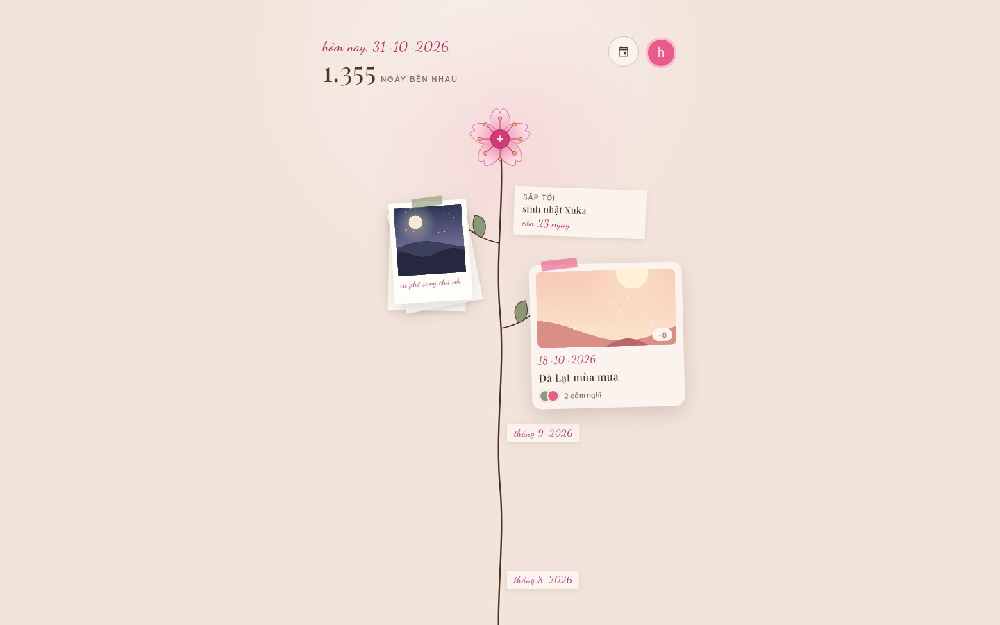

<p align="center">
  
</p>

<h1 align="center">us-together</h1>

<p align="center">
  Cuốn sổ ảnh chung của hai người, mọc thành một cành hoa anh đào.<br>
  <a href="https://ustogether.space">ustogether.space</a> ·
  <a href="https://github.com/hkhaNguyen/us-together/releases">APK Android</a>
</p>

<p align="center"><a href="README.md">English</a> · <b>Tiếng Việt</b></p>

Mỗi tấm ảnh hay kỷ niệm hai người thêm vào sẽ nhú ra trên một nhánh của cùng
một thân cây. Mới nhất nằm trên cùng, ngay dưới bông hoa; cũ nhất nằm dưới
gần chậu. Giao diện app bằng tiếng Việt.

Bản trên web và APK chỉ mở được cho hai người trong cuốn sổ này. Ai khác
đăng nhập sẽ thấy báo tài khoản chưa có trong sổ. Muốn dùng cho hai bạn thì
hãy tự dựng một bản riêng (xem [Tự dựng bản riêng](#tự-dựng-bản-riêng)).

<p align="center">
  
  
  
  
</p>
<p align="center">
  
</p>

Ảnh chụp màn hình dùng dữ liệu mẫu và ảnh minh hoạ tự vẽ.

## Tính năng

- **Thân cây**: ảnh và kỷ niệm mọc so le trái phải dọc một thân, có mốc
  từng tháng, từ bông hoa xuống tới chậu.
- **Ảnh lẻ**: mỗi lần thêm là một xấp polaroid dùng chung một tiêu đề. Có
  thể thêm ảnh vào xấp sau, hoặc chọn ảnh bìa cho xấp.
- **Kỷ niệm**: một câu chuyện có ngày, ảnh và ảnh bìa. Mỗi người viết cảm
  nghĩ của riêng mình bên dưới.
- **Ngày kỷ niệm**: đếm số ngày bên nhau, đếm ngược tới dịp sắp tới, và
  đúng ngày đó thì có trái tim cùng pháo giấy.
- **Xem từ đầu**: xem lại cả cuốn sổ. Vuốt lên từ chậu để thân cây mọc lại
  từng nhánh, kết thúc bằng con số ngày bên nhau.
- **Thùng giấy**: thứ bị xoá nằm chờ 30 ngày, ai trong hai người cũng khôi
  phục được.
- **Ảnh**: ngày chụp lấy từ EXIF, nén ngay trên máy (WebP, hoặc JPEG khi
  trình duyệt không hỗ trợ), phóng to và tải về được.
- **Ảnh đại diện**: chọn bằng khung cắt tròn, kéo và zoom được.

## Công nghệ

- **Flutter** cho Android và web, chung một bộ code.
- **Firebase**:
  - Authentication (đăng nhập Google)
  - Cloud Firestore
  - Cloud Storage
  - Hosting

Không có code phía máy chủ. Quyền truy cập do
[`firestore.rules`](firestore.rules) và [`storage.rules`](storage.rules)
quyết định. Config Firebase trong repo này được thiết kế để công khai: nó chỉ
cho biết dự án nào, tự nó không cấp quyền gì.

```text
lib/
  auth/           đăng nhập Google và cổng kiểm tra thành viên
  data/           model và JournalStore (mọi truy cập Firestore/Storage)
  home/           thân cây: timeline, bố cục, painter, xem từ đầu
  add/            sheet thêm ảnh, thêm kỷ niệm, xử lý ảnh
  moment/         trang một kỷ niệm: ảnh, câu chuyện, cảm nghĩ
  viewer/         xem ảnh toàn màn hình
  anniversaries/  danh sách và sửa ngày kỷ niệm
  trash/          thùng giấy 30 ngày
  theme/          màu, chữ, chuyển động
tool/             tạo icon
```

## Tự dựng bản riêng

Cần có Flutter (bản stable),
[Firebase CLI](https://firebase.google.com/docs/cli) và
[FlutterFire CLI](https://firebase.google.com/docs/flutter/setup).

1. **Tạo dự án Firebase.** Dự án phải dùng gói Blaze vì Cloud Storage cần
   gói này; hai người dùng thì vẫn nằm trong hạn mức miễn phí. Trong dự án,
   bật:
   - Authentication → đăng nhập Google
   - Firestore
   - Storage

2. **Trỏ app vào dự án của bạn.** Lệnh này thay `lib/firebase_options.dart`
   và `android/app/google-services.json`.

   ```sh
   flutterfire configure
   ```

   Sau đó sửa id dự án trong `.firebaserc`.

3. **Deploy rule bảo mật.** Khi CLI hỏi có cho rule của Storage đọc
   Firestore không, chọn đồng ý: rule cần kiểm tra thành viên ở đó.

   ```sh
   firebase deploy --only firestore:rules,storage
   ```

4. **Cho bản web tải dữ liệu ảnh.** Cần bước này để lưu ảnh về máy.

   ```sh
   gcloud storage buckets update gs://YOUR-BUCKET --cors-file=storage-cors.json
   ```

5. **Thêm hai người bằng tay** trong console Firestore. App không có chỗ
   nào ghi được hai mục này:

   | Tài liệu | Trường |
   | --- | --- |
   | `people/{personId}` | `name` (chuỗi), `color` (`"sakura"` hoặc `"sage"`) |
   | `members/{email}` | `person` (personId tương ứng) |

   Một người có thể dùng nhiều email: mỗi email thêm một tài liệu `members`.

6. **Chạy app.**

   ```sh
   flutter run -d chrome   # hoặc một máy Android
   ```

   Sau đó đặt ngày bắt đầu yêu bằng dòng chữ ở phần đầu trang chủ.

### Đăng nhập trên Android và bản release

- **Mã SHA.** Đăng nhập Google trên Android cần SHA-1 và SHA-256 của key ký
  app, thêm trong console Firebase ở Project settings → app Android của bạn.
  `cd android && ./gradlew signingReport` sẽ in ra hai mã này.
- **Ký bản release.** Tạo một keystore riêng, rồi thêm file
  `android/key.properties`. Git bỏ qua file này.

  ```properties
  storePassword=…
  keyPassword=…
  keyAlias=upload
  storeFile=/đường/dẫn/tới/upload.jks
  ```

  Nếu không có file này, bản release sẽ ký tạm bằng debug key.

### Đưa lên web

```sh
flutter build web --release
firebase deploy --only hosting
```

### Icon

Mọi icon đều được vẽ từ chính widget bông hoa trong app. Sửa hoa xong thì
tạo lại icon:

```sh
flutter test tool/make_icons_test.dart
```

### Ảnh chụp màn hình

Các ảnh ở trên được chụp từ chính app chạy với dữ liệu mẫu
([`tool/screenshots/demo_main.dart`](tool/screenshots/demo_main.dart)),
bằng Chrome chạy ngầm. Chụp lại vào `.github/screenshots/`:

```sh
node tool/screenshots/shoot.mjs
```

## Giấy phép

[MIT](LICENSE)
