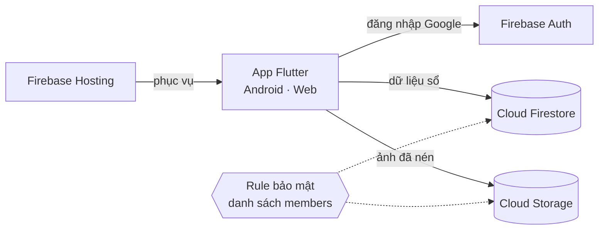

<div align="center">


# us-together

[](https://flutter.dev)
[](https://firebase.google.com)
[](https://github.com/hkhaNguyen/us-together/releases)
[](LICENSE)

Cuốn sổ ảnh chung của hai người, mọc thành một cành hoa anh đào.

[Giới thiệu](#giới-thiệu) · [Tính năng](#tính-năng) · [Tự dựng bản riêng](#tự-dựng-bản-riêng) · [Triển khai](#triển-khai) · [Phát triển](#phát-triển) · [English](README.md)


</div>

## Giới thiệu

us-together là cuốn sổ riêng mà hai người cùng viết. Mỗi tấm ảnh hay kỷ niệm
ai thêm vào cũng nhú ra trên một nhánh của cùng một thân cây: mới nhất nằm
ngay dưới bông hoa trên đỉnh, cũ nhất nằm dưới gần chậu. Giao diện app bằng
tiếng Việt.

App chạy trên Android và trình duyệt từ cùng một bộ code Flutter, toàn bộ
phía máy chủ là Firebase. Không có code máy chủ nào: đăng nhập Google cho
biết bạn là ai, còn rule bảo mật quyết định bạn có phải một trong hai người
hay không.



Bản web [ustogether.space](https://ustogether.space) và APK chỉ mở được cho
hai người trong cuốn sổ này. Ai khác đăng nhập sẽ thấy báo tài khoản chưa có
trong sổ. Muốn dùng cho hai bạn thì hãy tự dựng một bản riêng.

## Tính năng

- **Thân cây**: ảnh và kỷ niệm mọc so le trái phải dọc một thân, có mốc từng
  tháng, từ bông hoa xuống tới chậu.
- **Ảnh lẻ**: mỗi lần thêm là một xấp polaroid dùng chung một tiêu đề. Có thể
  thêm ảnh vào xấp sau, hoặc chọn ảnh bìa cho xấp.
- **Kỷ niệm**: một câu chuyện có ngày, ảnh và ảnh bìa. Mỗi người viết cảm
  nghĩ của riêng mình bên dưới.
- **Ngày kỷ niệm**: đếm số ngày bên nhau, đếm ngược tới dịp sắp tới, và đúng
  ngày đó thì có trái tim cùng pháo giấy.
- **Xem từ đầu**: xem lại cả cuốn sổ từ chậu lên, thân cây mọc lại từng nhánh
  và kết thúc bằng con số ngày bên nhau.
- **Thùng giấy**: thứ bị xoá nằm chờ 30 ngày, ai trong hai người cũng khôi
  phục được.
- **Ảnh**: ngày chụp lấy từ EXIF, nén ngay trên máy (WebP, hoặc JPEG khi
  trình duyệt không hỗ trợ), phóng to và tải về được.

## Tự dựng bản riêng

Cần có [Flutter](https://docs.flutter.dev/get-started/install) (bản stable),
[Firebase CLI](https://firebase.google.com/docs/cli) và
[FlutterFire CLI](https://firebase.google.com/docs/flutter/setup).

> [!IMPORTANT]
> Cloud Storage cần gói **Blaze** (trả theo mức dùng) của Firebase. Hai người
> dùng thì vẫn nằm gọn trong hạn mức miễn phí, nhưng vẫn nên đặt cảnh báo
> ngân sách trong Google Cloud Billing.

1. **Tạo dự án Firebase**, rồi bật Authentication với đăng nhập Google,
   Firestore và Storage.

2. **Trỏ app vào dự án của bạn.** Lệnh này viết lại
   `lib/firebase_options.dart` và `android/app/google-services.json`; sau đó
   sửa id dự án trong `.firebaserc`.

   ```sh
   flutterfire configure
   ```

3. **Deploy rule bảo mật.** Khi CLI hỏi có cho rule của Storage đọc Firestore
   không, chọn đồng ý: thành viên được kiểm tra ở đó.

   ```sh
   firebase deploy --only firestore:rules,storage
   ```

4. **Cho bản web tải dữ liệu ảnh.** Cần bước này để lưu ảnh về máy.

   ```sh
   gcloud storage buckets update gs://YOUR-BUCKET --cors-file=storage-cors.json
   ```

5. **Thêm hai người** trong console Firestore. App không có chỗ nào ghi được
   các tài liệu này:

   | Tài liệu | Trường |
   | --- | --- |
   | `people/{personId}` | `name` (chuỗi), `color` (`"sakura"` hoặc `"sage"`) |
   | `members/{email}` | `person` (personId tương ứng) |

   > [!TIP]
   > Ai dùng nhiều tài khoản Google thì mỗi email thêm một tài liệu `members`,
   > tất cả trỏ về cùng một người.

6. **Chạy app**, rồi đặt ngày bắt đầu yêu bằng dòng chữ ở phần đầu trang chủ.

   ```sh
   flutter run -d chrome   # hoặc một máy Android
   ```

> [!NOTE]
> Config Firebase trong repo này được thiết kế để công khai: nó chỉ cho biết
> dự án nào, tự nó không cấp quyền gì. Mọi lệnh đọc và ghi đều đi qua
> [`firestore.rules`](firestore.rules) và [`storage.rules`](storage.rules).

## Triển khai

### Web

```sh
flutter build web --release
firebase deploy --only hosting
```

`firebase.json` phục vụ app dạng một trang và không để trình duyệt giữ bản
`main.dart.js` cũ sau mỗi lần deploy.

### Android

Đăng nhập Google trên Android cần SHA-1 và SHA-256 của key ký app, thêm trong
console Firebase ở Project settings → app Android của bạn.
`cd android && ./gradlew signingReport` sẽ in ra hai mã này.

Bản release được ký bằng key mà `android/key.properties` trỏ tới. Git bỏ qua
file này.

```properties
storePassword=…
keyPassword=…
keyAlias=upload
storeFile=/đường/dẫn/tới/upload.jks
```

```sh
flutter build apk --release
```

> [!WARNING]
> Hãy sao lưu keystore và mật khẩu của nó. APK ký bằng key khác không cập
> nhật đè được lên app đã cài, nên mất chúng thì cả hai máy phải gỡ app rồi
> cài lại.

## Phát triển

```text
lib/
  auth/           đăng nhập Google và cổng kiểm tra thành viên
  data/           model và JournalStore (mọi truy cập Firestore/Storage)
  home/           thân cây: timeline, bố cục, painter, xem từ đầu
  add/            sheet thêm ảnh, thêm kỷ niệm, xử lý ảnh
  moment/         trang một kỷ niệm: ảnh, câu chuyện, cảm nghĩ
  viewer/         xem ảnh toàn màn hình
  anniversaries/  danh sách và sửa ngày kỷ niệm
  trash/          thùng giấy 30 ngày
  theme/          màu, chữ, chuyển động
tool/             tạo icon và ảnh chụp màn hình
```

| Việc | Lệnh |
| --- | --- |
| Chạy test | `flutter test` |
| Tạo lại icon từ widget bông hoa | `flutter test tool/make_icons_test.dart` |
| Chụp lại màn hình vào `.github/screenshots/` | `node tool/screenshots/shoot.mjs` |

Ảnh chụp màn hình lấy từ chính app chạy với dữ liệu mẫu
([`tool/screenshots/demo_main.dart`](tool/screenshots/demo_main.dart)) và ảnh
minh hoạ tự vẽ, chụp bằng Chrome chạy ngầm.
